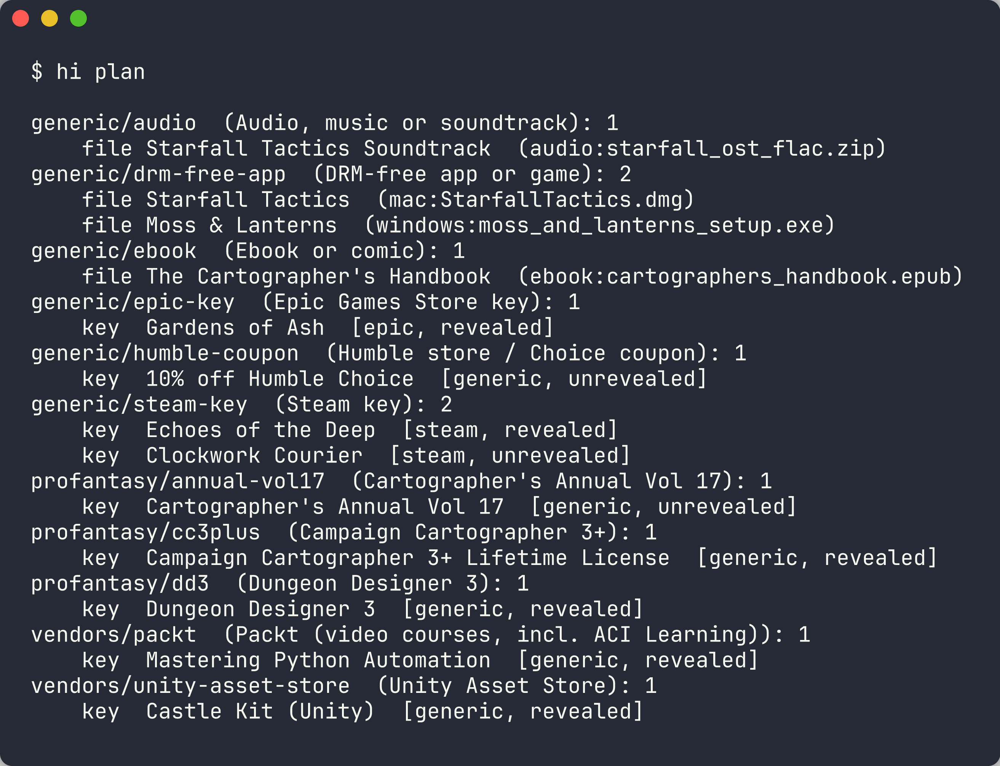
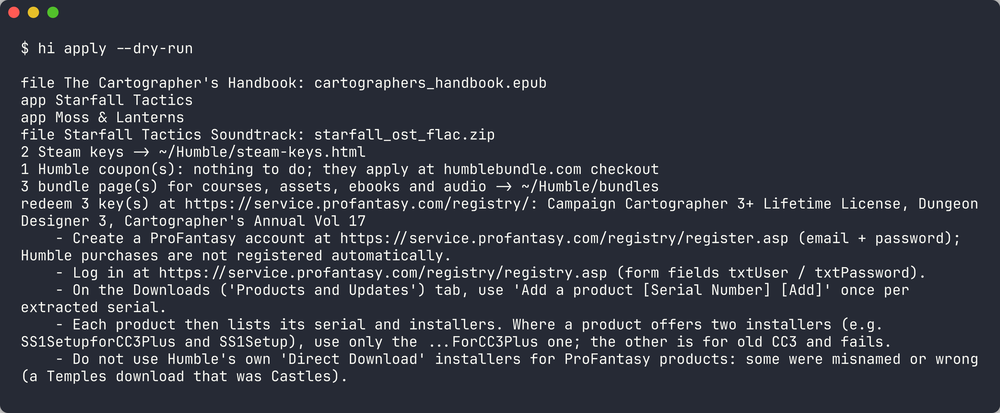
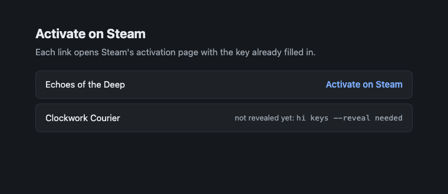
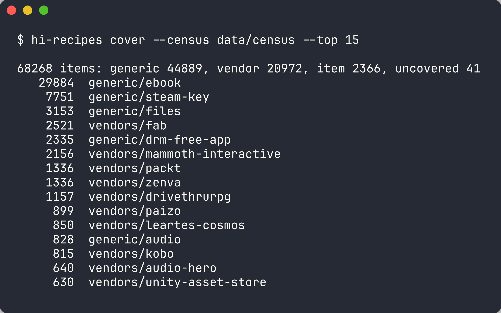

# humble-integrator

Gets everything in a Humble Bundle account into Steam, on macOS and Linux.

> **Unofficial.** Not affiliated with or endorsed by Humble Bundle, Valve or
> any vendor named in the recipes. It talks to Humble's undocumented library
> API with *your own* logged-in session, and only ever acts on your own
> purchases. Early (0.x): see [Status](#status) before trusting it with keys.

- **Steam keys** are extracted from your Humble account and activated on Steam
  (as real Steam games).
- **DRM-free games and apps** are downloaded (md5-checked), installed without
  root, and added to Steam as non-Steam shortcuts with artwork. Windows-only
  builds run through Wine on macOS and Proton (umu-launcher) on Linux.
- **Vendor keys** (ProFantasy serials, Packt/Zenva course codes, Unity/Fab
  vouchers, Ovani audio, …) go to the vendor's own redemption, following a
  recipe; desktop apps among them become Steam shortcuts too.
- **Ebooks, audio, asset packs, 3D-print files, courses** are downloaded into a
  library folder (or redeemed with their vendor). Each Humble bundle with such
  content gets **one** Steam entry that opens a page for that bundle: its
  downloaded folders and the keys still to redeem — so a 300-ebook bundle is
  one library entry, not 300. Turn off with `bundle_shortcuts = false`.

## Screenshots

From a fake demo account (`docs/demo/seed_demo_account.py`; regenerate with
`docs/demo/screenshots.sh`). Games are invented and every key is a `DEMO-…`
placeholder; the vendor items use real Humble machine names, so they resolve to
their real recipes.

`hi plan` sorts everything the account owns by route — Steam keys, DRM-free
builds, vendor keys (here ProFantasy serials, a Packt voucher, a Unity voucher),
Epic keys, ebooks, audio, Humble's own coupons:



`hi apply --dry-run` shows what it would do: install builds as Steam shortcuts,
fetch files, write the Steam activation page, and give one set of redemption
steps per vendor:



The Steam activation page — each link opens Steam's own activation page with the
key filled in; unrevealed keys say how to reveal them:



Recipe coverage over the census of Humble bundles:



## How it works

Every Humble item resolves to a *recipe* (see `recipes/README.md`): an item
recipe, a vendor recipe, or a generic route. `hi-recipes cover` measures how
much of every Humble bundle ever sold is covered.

## Use

```sh
nix run github:l1n/humble-integrator -- plan
# without Nix: Python 3.11+, no dependencies
git clone https://github.com/l1n/humble-integrator && cd humble-integrator
python3 humble_integrator/cli.py plan
```

Optional tools it uses when present: `7zz`/`7z` (vendor self-extractors),
`umu-run` (Linux, Windows builds via Proton), a Wine/CrossOver/Kegworks `wine`
(macOS, Windows-only builds). The Nix package puts 7-Zip and umu-launcher on
its path.

1. Log in at humblebundle.com and copy the `_simpleauth_sess` cookie. Store it
   (both commands prompt, so it stays out of shell history):
   - macOS: `security add-generic-password -s humble-integrator -a _simpleauth_sess -w`
   - Linux: `secret-tool store --label='Humble session' service humble-integrator key _simpleauth_sess`
2. `hi keys` — pulls every order and every key into a private keystore (0600).
   Nothing is revealed unless you ask: `hi keys --reveal needed` reveals keys
   for things you don't already own (revealing a Humble key is irreversible:
   it can no longer be gifted).
3. `hi plan` — shows what each item will go through.
4. `hi apply --dry-run`, then `hi apply` (quit Steam first so shortcuts stick).

Optional config: `~/.config/humble-integrator/config.toml` (see `hi --help`).

## Safety defaults

- Keys are never revealed, redeemed or gifted without an explicit flag.
- The installer driver (`hi-drive`) types *your own* serial into a vendor's
  installer; the vendor's licence check still runs. It never accepts a
  licence agreement unless you list that vendor in `accept_eulas`, and it
  stops rather than touch an "already installed: repair/remove" page.
- Steam files are backed up before every write; only entries tagged
  `Humble` are ever changed or removed; nothing is written while Steam runs.
- Archives can't write outside their install folder.

## Status

Verified by tests (`tests/`, run in the Nix build): recipe resolution and
ordering, key extraction logic, download resume + md5, archive unpacking and
launcher detection, Steam `shortcuts.vdf` / `config.vdf` writing, the
installer-driver script generation, and the `hi` plan/apply flow on a fake
account.

Verified live: the installer driver runs AutoHotkey inside Wine and sees a
real ProFantasy (InstallAware) installer's windows. Whisky's Wine 7.7 hangs at
the installer's verify step (a known issue); Wine 10 gets past it to the
wizard. The driver's full walk through the wizard has not been run yet.

Not yet verified against a real account: Humble's API field names (taken from
existing open-source tools), Steam activation, and the vendor recipes, all of
which are `verified = false` until someone runs them end to end — that's the
most useful contribution (see `CONTRIBUTING.md`).

Recipe coverage: 539 recipes (117 vendors, 416 products, 6 generic routes) resolve every item of every
software bundle in the census so far; game and book bundles are being added.
Run `python3 humble_integrator/recipes.py cover --census data/census`
for the current numbers.

## Data

`data/census/` (one file each for software, games and books) lists Humble bundles and their items (tiers, delivery
methods, developers, redemption text, a short description), rebuilt from
Wayback Machine snapshots of humblebundle.com taken while each bundle was live.
Text in it is Humble's and the publishers'. Rebuild or extend it with
`hi-census list`, `hi-census fetch --skip-census data/census`,
`hi-census parse --out data/census` (be gentle: archive.org refuses
connections above a few requests a second).

## License

MIT (see `LICENSE`). Recipes cite their sources; vendor names and trademarks
belong to their owners.

## Pieces

| Command | Module | Does |
|---|---|---|
| `hi` | `cli.py` | keys → plan → apply |
| `hi-humble` | `humble.py` | Humble API: orders, keys, reveal, downloads |
| `hi-recipes` | `recipes.py` | load/check recipes, coverage, install order |
| `hi-census` | `census.py` | every Humble bundle ever, from Wayback snapshots |
| `hi-install` | `install.py` | unpack builds, find launchers, silent installer switches |
| `hi-drive` | `drive.py` | drive an installer wizard under Wine (serial entry) |
| `hi-steam` | `steam.py` | non-Steam shortcuts, artwork, Proton mapping |
